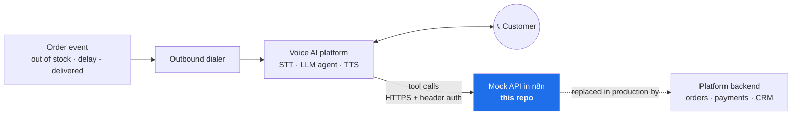

# Arabic Voice Agent — Food Delivery Outbound Calls (Mock API)

An n8n mock backend for an **Arabic AI voice agent that calls food-delivery customers**: when an item is out of stock, when an order is running late, or after delivery to collect feedback. The agent verifies the customer, reads the order, offers only the resolutions the backend allows, grants policy-limited compensation, opens support tickets, and logs the call.

> ⚠️ **Mock API.** Every response is mock data for a fictional platform ("DemoEats"). No real orders, customers, payments or vouchers are involved.

## Scope of this repository

This repo contains **one layer** of the voice-agent systems I build: the **backend API contract and mock services** the agent calls during a live call, used to design, test and demo the agent before it is connected to a real platform.



In production deployments this layer is swapped for the client's real backend, and sits alongside parts I can't publish because they are covered by client confidentiality agreements: agent prompts and conversation design, real integrations, and evaluation data. Everything here is generic and contains no client information.

I build Arabic voice agents for clients across telecom, banking, healthcare, government, aviation and food delivery in the GCC and Levant.

## Design principles

**The LLM never decides money.** The agent doesn't choose what to offer. `resolution-options` returns the `allowedActions` for this issue, and `compensations/evaluate` returns the policy's `suggestedAmount` and `maxAmount`. The agent can only present what the backend permits.

**Guardrails are enforced server-side, not just in the prompt.** `vouchers/grant` rejects any amount above the policy maximum or beyond the customer's period limit, and both money-moving endpoints refuse to act without a valid `verificationToken`. If the agent is talked into offering more, the backend still says no.

**Context before conversation.** An outbound call starts by fetching `outbound-calls/context`, so the agent knows who it is calling, why (`callType`, `reasonCode`), and which script variables to use before it says a word.

**One response envelope for everything.** Every endpoint returns the same shape, so the agent's error handling is uniform:

```json
{ "success": false,
  "error": { "code": "AMOUNT_EXCEEDS_POLICY", "message": "…", "retryable": false, "details": { "maxAmount": 20 } },
  "meta":  { "correlationId": "call_001", "timestamp": "…" } }
```

`retryable` tells the agent whether to try again or apologize and escalate, and `correlationId` (from the `x-correlation-id` header) ties every tool call back to one phone call.

**Testable failure paths.** Add `?mockError=1` or header `x-mock-error: 1` to any request to force an error, so you can test how the agent handles a failing backend mid-call.

## Call types

| Call ID (`x-correlation-id`) | `callType` | Scenario |
|---|---|---|
| `call_out_10` (default) | `OUT_OF_STOCK` | An item in the order is unavailable; agent offers replace or remove |
| `call_out_20` | `DELAY_NOTIFICATION` | Order is 30+ minutes late; agent apologizes and offers a voucher |
| `call_out_30` | `FEEDBACK` | Post-delivery survey; low ratings open a follow-up ticket |

## Endpoints

All paths are under `/webhook/demoeats/v1/`.

| Method | Path | Purpose |
|---|---|---|
| GET | `outbound-calls/context` | Why we're calling: customer, order, trigger, script variables |
| POST | `customers/verify` | Verify the customer, returns a short-lived `verificationToken` |
| GET | `orders/context` | Order status, ETA, delay, items, total |
| GET | `orders/resolution-options` | Allowed actions and replacement options (`?issueType=MISSING_ITEM` for refunds) |
| POST | `orders/apply-resolution` | Apply `REPLACE_ITEM`, `REMOVE_ITEM`, `REFUND_ITEM` or `CANCEL_ORDER` · requires token |
| POST | `compensations/evaluate` | Policy check: eligible, suggested and max amount |
| POST | `vouchers/grant` | Grant a voucher within policy limits · requires token |
| POST | `feedback` | Record a 1–5 rating; returns sentiment and whether follow-up is needed |
| POST | `tickets` | Open a support ticket |
| POST | `calls/complete` | Log the call outcome and close the outbound task |

## Setup

1. In n8n, **Import from file** → `workflow/food-delivery-mock-api.json`.
2. Create a **Header Auth** credential (e.g. header `x-api-key` with a long random value) and select it on all ten webhook nodes.
3. Activate the workflow and register each endpoint as a tool in your voice AI platform, sending the auth header and `x-correlation-id`.

Try a guardrail:

```bash
curl -X POST "$N8N/webhook/demoeats/v1/vouchers/grant" \
  -H "x-api-key: $KEY" -H "Content-Type: application/json" \
  -d '{"verificationToken":"ver_demo_7f3a9c","amount":50}'
# → AMOUNT_EXCEEDS_POLICY, maxAmount 20
```
